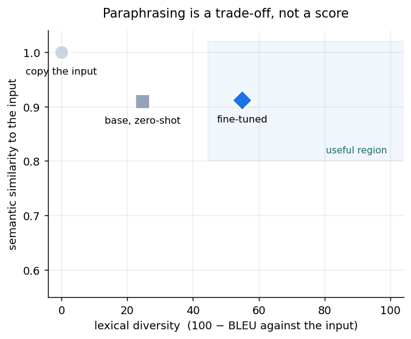
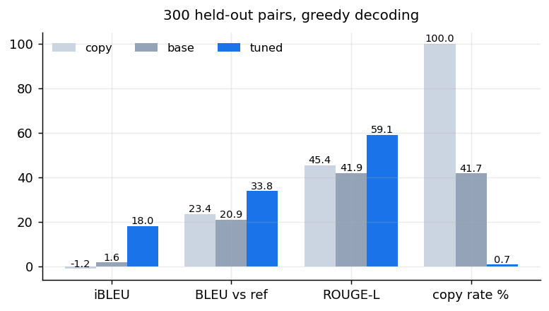
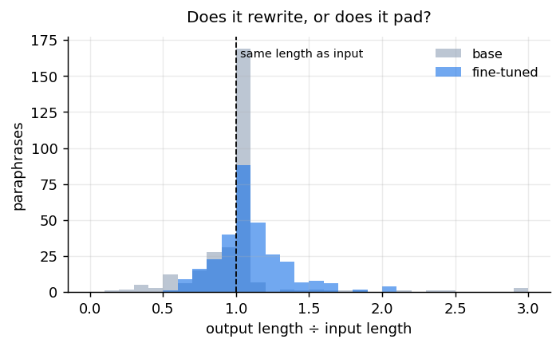
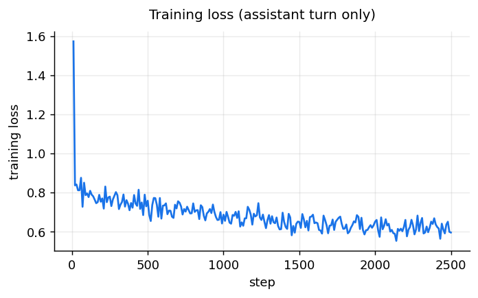
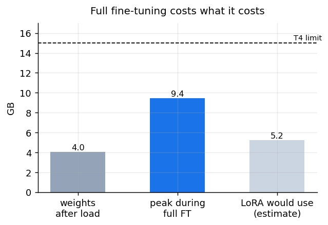

<p align="center">
  <a href="https://huggingface.co/emonHasan01/gemma-3-1b-paraphrase">
    
  </a>
  <a href="https://huggingface.co/google/gemma-3-1b-it">
    
  </a>
  
  
  
  
</p>


<div align="center">

[Hugging Face](https://huggingface.co/emonHasan01) | [GitHub](https://github.com/Md-Emon-Hasan) | [LinkedIn](https://www.linkedin.com/in/md-emon-hasan-695483237/) | [WhatsApp](https://wa.me/8801834363533) | [Portfolio](https://emonlabs-ai.hitechparks.com/)

**Author:** [Md. Emon Hasan](https://huggingface.co/emonHasan01)

</div>

# gemma-3-1b-paraphrase

**A 1B paraphraser, fully fine-tuned.** Every weight of
[`google/gemma-3-1b-it`](https://huggingface.co/google/gemma-3-1b-it) was updated — no adapters — using
[Unsloth](https://github.com/unslothai/unsloth) on
[`humarin/chatgpt-paraphrases`](https://huggingface.co/datasets/humarin/chatgpt-paraphrases)

iBLEU rises from 1.65 to 17.99, with semantic similarity held at 0.911.

## Why one number cannot grade a paraphraser

A paraphrase has to do two things that pull against each other:

- **keep the meaning** — maximised by returning the input unchanged
- **change the wording** — maximised by writing something unrelated

So any single metric can be gamed. Copying the input scores a perfect **1.000** semantic
similarity and is worthless. This card therefore reports both axes, and includes a **copy
baseline** so the trade-off is visible rather than implied.



Read that plot before the tables. Top-right is good; anything near the top-left corner is
a model that has learned to echo.

## Results

300 held-out pairs, greedy decoding, identical prompt for every system.

| | semantic similarity ↑ | lexical diversity ↑ | iBLEU ↑ | BLEU vs ref ↑ | ROUGE-L ↑ | copy rate ↓ | length ratio |
|---|---|---|---|---|---|---|---|
| copy the input | 1.000 | -0.0 | -1.24 | 23.45 | 45.38 | 100.0% | 1.00 |
| `google/gemma-3-1b-it` zero-shot | 0.909 | 24.6 | 1.65 | 20.91 | 41.87 | 41.7% | 1.05 |
| **this model** | 0.911 | 54.9 | 17.99 | 33.76 | 59.06 | 0.7% | 1.09 |



**How to read each column.** *Semantic similarity* is cosine distance between
`all-MiniLM-L6-v2` embeddings of input and output. *Lexical diversity* is
`100 − BLEU(output, input)`, so higher means less copying. *iBLEU* is the standard combined
paraphrase measure, `0.8 × BLEU(output, reference) − 0.2 × BLEU(output, input)` — it rewards
matching a human paraphrase and penalises echoing the source. *Copy rate* is the share of
outputs identical to the input.





## Examples

| Source | Human reference | Base, zero-shot | This model |
|---|---|---|---|
| Where from can I get best UX design course in India? | What are the top-rated UX design courses available in India? | Where can I get best UX design course in India? | What is the best place to get UX design course in India? |
| Are there any Progressive Christian dating websites? | Is there a dating website for Progressive Christians? | Are there any dating websites for Christian dating? | Are there any websites that cater to Progressive Christian dat |
| Why is my dog shaking so much? | What is causing my dog to shake excessively? | Why is my dog shaking so much? | What is causing my dog to shake so much? |
| Which tools do start up accelerators use to track the progress | What are the tracking tools utilized by start-up accelerators  | Which tools do start accelerators use to track the progress of | What are the tools that start up accelerators use to monitor t |
| Does whatsapp use distributed storage among the clients in a g | Is distributed storage utilized by WhatsApp among group client | Does whatsapp use distributed storage among the clients in a g | Is it possible to use distributed storage among the clients in |

## Usage

```python
from transformers import AutoTokenizer, AutoModelForCausalLM
import torch

tok = AutoTokenizer.from_pretrained("emonHasan01/gemma-3-1b-paraphrase")
model = AutoModelForCausalLM.from_pretrained("emonHasan01/gemma-3-1b-paraphrase", torch_dtype=torch.float16,
                                             device_map="auto")

# Gemma 3 has no system role — the instruction goes in the user turn
INSTRUCTION = ("Rewrite the sentence below. Keep the meaning exactly the same, change the "
               "wording and structure, and return only the rewritten sentence.\n\n{src}")

messages = [{"role": "user", "content": INSTRUCTION.format(src="The cat sat on the mat.")}]
prompt = tok.apply_chat_template(messages, tokenize=False, add_generation_prompt=True)
prompt = prompt.removeprefix("<bos>")   # the tokenizer adds one; two degrades output
inputs = tok(prompt, return_tensors="pt", add_special_tokens=False).to(model.device)
out = model.generate(**inputs, max_new_tokens=72, do_sample=False)
print(tok.decode(out[0][inputs["input_ids"].shape[1]:], skip_special_tokens=True))
```

**Several different paraphrases of the same sentence:**

```python
out = model.generate(**inputs, max_new_tokens=72, do_sample=True,
                     temperature=0.9, top_p=0.95, num_return_sequences=4)
```

Greedy decoding reproduces the numbers above. Sampling at `temperature=0.9` gives variety
at some cost to fidelity — raise it for brainstorming, keep it greedy when the meaning must
hold. Google's recommended settings for general Gemma 3 use are `temperature=1.0`,
`top_k=64`, `top_p=0.95`; for paraphrasing those produce noticeably looser rewrites.

**The instruction wording is part of the model.** Gemma 3's chat template has no `system`
role, so the instruction was folded into the user turn — exactly as shown above — in every
training example. A different wrapper degrades the output format. Exact strings in
[`prompt_format.json`](prompt_format.json).

**Strip the duplicate `<bos>`.** Gemma's chat template emits one, and the tokenizer adds
another unless you remove it. Two BOS tokens measurably degrade quality, and nothing warns
you.

## Training

| | |
|---|---|
| Method | **Full fine-tuning** — every non-embedding weight updated |
| Base model | `google/gemma-3-1b-it` (1.00B parameters), loaded from the `unsloth/` mirror |
| Trainable | 697,896,064 (69.8%); embeddings frozen (30.2%) |
| Learning rate | 1e-05, cosine schedule, 3% warmup |
| Batch | 4 × 4 accumulation = 16 effective |
| Steps | 2500 (~40,000 examples) |
| Max sequence | 256 tokens |
| Optimizer | `adamw_8bit`, `max_grad_norm=1.0`, gradient checkpointing |
| Precision | **pure float32** — Gemma 3 overflows float16 (see below) |
| Energy | ~0.18 kWh, ≈0.075 kg CO₂e at the global average grid |



### Decisions that mattered

**Learning rate `1e-05`, not `2e-4`.** This is the most common way to ruin a full
fine-tune. LoRA uses 1e-4 to 5e-4 because a few million parameters carry the entire update.
Full fine-tuning moves every weight, so that rate overwrites the pretraining and the model
stops writing fluent English. Full fine-tuning lives at 1e-5 to 2e-5.

**Embeddings frozen.** Gemma 3's vocabulary is 262,144 tokens, so `embed_tokens` is
262,144 × 1,152 = 302M parameters — 30.2% of this entire model, with `lm_head` tied
to it. Paraphrasing adds no vocabulary, so training it buys very little while costing
gradients plus optimizer state for nearly a third of the network. In fp32 that is the
difference between fitting on a T4 and not: peak memory lands at 9.4 GB rather
than against the 15 GB ceiling.

**Gemma 3 cannot be trained in float16 at all.** Its activations exceed float16's maximum
of 65,504, so gradients and activations become infinity on any card with float16 tensor
cores but no bfloat16 — T4, V100, RTX 20-series. This is the model's dynamic range, not a
bug in the training script, and Unsloth's remedy is to default every layer to float32.
Training here therefore runs in **pure fp32**: slower than mixed precision, and every
memory estimate that assumes 2 bytes per weight is wrong by half. On Ampere or newer,
bfloat16 sidesteps the whole problem.

**`FastModel`, not `FastLanguageModel`.** Gemma 3 needs the multimodal-aware loader even
for the text-only 1B, and the older loader fails or misconfigures the model.

**Loss on the assistant turn only.** `train_on_responses_only` masks the prompt. Otherwise
most of the gradient goes into regenerating the input sentence, which is always supplied.

**Pairs filtered and deduplicated.** Identical pairs, length ratios outside 0.5–2.0, and
repeated source sentences were dropped before training. Duplicate sources inflate held-out
scores by leaking training text into evaluation.

### Would LoRA have done as well?

Probably. Unsloth's own guidance is that full fine-tuning is usually unnecessary and that
LoRA matches it when done properly. This model is a full fine-tune because that was the
brief, and because the memory wall is worth seeing. **It is not evidence that full
fine-tuning beats LoRA here** — that comparison was not run, and the card would say so if
it had been.

## Intended use

Rewriting a sentence while preserving meaning: varying phrasing in drafts, generating
training data, simplifying repetitive text, producing alternatives for a human to choose
between.

## Out of scope

- **Evading plagiarism or AI detection.** Rewording a source does not make it yours, and
  the model was not trained or evaluated for that.
- **Legal, medical or safety-critical text**, where a subtle meaning shift matters and
  nothing here verifies that meaning survived.
- **Anything non-English.** Gemma 3 is multilingual, but this fine-tune used English data
  only and was evaluated in English only. Other languages are unmeasured and the instruction
  format was never trained in them.

## Limitations

- **Semantic similarity is measured by a 22M-parameter embedding model**, not by a human.
  It can rate a meaning-changing rewrite as similar, particularly when a negation flips or
  a number changes. No human evaluation was run.
- **One paraphrase per input during evaluation.** Diversity across samples was not measured.
- **Evaluated on 300 pairs** from one dataset. Expect sampling noise of a point or
  two on BLEU-based numbers.
- **The references are themselves machine-generated** (ChatGPT paraphrases), so BLEU against
  them measures agreement with another model, not with a human standard.
- **Sentence-length inputs.** Trained at 256 tokens; paragraphs and documents are out
  of distribution.
- **It can drop or alter details** — numbers, names, negations — while producing fluent,
  confident output. Check anything that matters.
- **1B parameters.** Dedicated paraphrase models and larger general models will do better.
  This is a small model trained on a free GPU in under two hours.

## Reproducing

The zero-shot baseline, the training, all five charts and this card. Raw numbers in
[`results.json`](results.json), prompt in [`prompt_format.json`](prompt_format.json).

## Citation

```bibtex
@software{unsloth,
  title  = {Unsloth},
  author = {Daniel Han and Michael Han and Unsloth team},
  year   = {2023},
  url    = {https://github.com/unslothai/unsloth}
}
@inproceedings{sun2012ibleu,
  title     = {Joint Learning of a Dual SMT System for Paraphrase Generation},
  author    = {Sun, Hong and Zhou, Ming},
  booktitle = {ACL},
  year      = {2012}
}
```